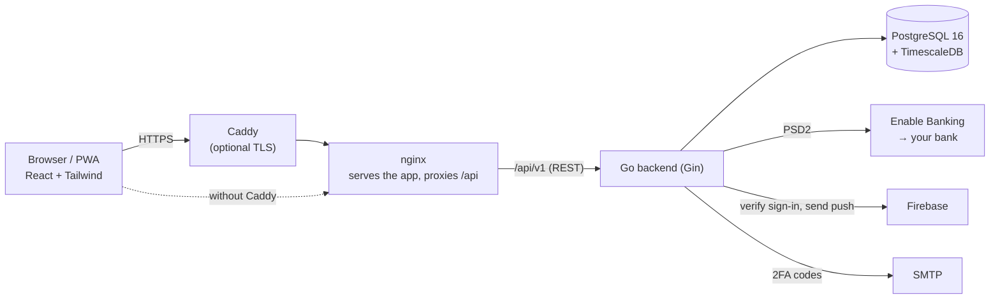

# PFF — Personal Finance Fotonica

A self-hosted analytics platform for your personal finances. PFF reads your bank
accounts through a PSD2 open-banking API, keeps a local copy of every transaction,
and turns them into metrics, history, spending breakdowns and budget alerts.

It runs as a single Docker Compose stack on your own machine or server: a Go
backend, a React web app you can install on your phone (PWA), and a
PostgreSQL + TimescaleDB database.

> **Status:** first full implementation. The backend, web app and Docker stack are
> built and tested (unit tests and an end-to-end test against TimescaleDB).
> PFF has **not yet been tested against a real bank or a real Firebase project**.
> The demo mode below runs everything with generated data.

---

## Contents

- [What PFF does](#what-pff-does)
- [Try it in two minutes (demo mode)](#try-it-in-two-minutes-demo-mode)
- [Using the app](#using-the-app)
- [Running it for real](#running-it-for-real)
- [How it works](#how-it-works)
- [Project layout](#project-layout)
- [Development](#development)
- [Limitations](#limitations)

---

## What PFF does

PFF answers three questions about your money: *how much*, *where to*, and *am I
over budget?*

| Feature | What you get |
|---|---|
| **Metrics** | For each metric domain and date range: **Total**, **Mean** (per transaction), **Max-Min** (largest, smallest and the spread between them), and the transaction count. |
| **History** | Every transaction in a domain and range, plus a time-series chart. Open any entry to see its full detail. |
| **Allocation** | How a domain splits across its metric classes, in percentages (e.g. 32 % groceries, 18 % restaurants). |
| **Budgets** | A spending cap per domain (optionally one class) and period. PFF sends a push notification when you reach a warning threshold (80 % by default) and when you go over the limit. |

### Metric domains

A *metric domain* is a way of looking at your transactions. Each domain is split
into *metric classes*:

| Domain | Classes |
|---|---|
| **Spending**: money going out, by payment channel | card, direct debit, transfer, cash withdrawal, fee, other |
| **Spending by category**: money going out, by what you bought | groceries, restaurants, transport, housing, utilities, health, shopping, entertainment, travel, subscriptions, education, taxes, fees, cash, transfers, other |
| **Income**: money coming in, by source | salary, refund, interest & dividends, received transfers, other |
| **Bank transfers**: transfers, by direction | incoming, outgoing, between own accounts |

Moving money between your own accounts is never counted as spending or income.
It only appears under *Bank transfers → between own accounts*.

### Date ranges

You can analyse the last **1 day**, **1 week**, **2 weeks**, **1 month**,
**3 months**, or a **custom** range. Budgets use calendar periods instead (today,
this week, this fortnight, this month, this quarter, or custom), so an alert fires
at most once per period.

---

## Try it in two minutes (demo mode)

Demo mode runs the whole stack with no accounts or credentials. It uses a fake
bank called *PFF Demo Bank* with realistic generated transactions, a simple
e-mail sign-in in place of Google, and it writes notifications and e-mail codes to
the backend log.

**You need:** Docker with Compose v2, `make`, and `git`.

```bash
git clone https://github.com/cecinuga/pff.git
cd pff

# Create the local config files from the templates
cp cluster/.env.dev.example cluster/.env.dev
cp cluster/config/allowed-emails.txt.example cluster/config/allowed-emails.txt

# Start the stack (first build takes a few minutes)
make demo
```

Then:

1. Open **http://localhost:8080**.
2. Sign in with `you@example.com`. Only addresses listed in
   `cluster/config/allowed-emails.txt` are let in, so add your own there if you
   prefer (one per line), then restart with `make demo`.
3. Go to **Bank connections**, connect **PFF Demo Bank**, and wait a few seconds
   while PFF loads two years of demo history.
4. Explore the **Overview**, open a domain, and create a **Budget**.

Stop everything with `make demo-down`. Your demo data stays in a Docker volume
until you remove it (`docker volume rm pff_pff-db`).

> To see push notifications and e-mail codes in demo mode, follow the backend log:
> `docker logs -f pff-ms-1`.

---

## Using the app

| Page | What it is for |
|---|---|
| **Overview** | Total, mean and max-min for every domain in the chosen range. |
| **Domain pages** (Spending, Spending by category, Income, Bank transfers) | Metrics, a chart over time, allocation by class, and the transaction history. Click a class to filter, click a transaction for its full detail. In the detail view you can change a transaction's category if PFF guessed wrong. |
| **Budgets** | Create, edit, pause and delete budgets, and see how much of each one you have used. |
| **Bank connections** | Connect a bank (you confirm the access on your bank's own page), see when each consent expires, and revoke it at any time. |
| **Notifications** | Budget alerts and reminders, for example when a bank consent is about to expire. |
| **Settings** | Your account, two-factor authentication (authenticator app, SMS or e-mail code) and push notifications on this device. |

**On your phone:** open PFF in the browser and choose *Add to Home Screen*
(*Install app* on Android). Push notifications need HTTPS and, on iPhone, the app
installed on the Home Screen.

**Freshness:** if your bank can't be reached, PFF still shows the data it already
has and tells you which days might be out of date.

---

## Running it for real

Running PFF with your real bank needs three outside services and a server with a
domain name. Google sign-in, web push and the bank redirect all require HTTPS.

### 1. Prerequisites

- A Linux host with Docker and Compose v2, and `make`.
- A domain (e.g. `pff.example.com`) whose DNS points to that host, with ports 80
  and 443 open. The bundled Caddy server gets the HTTPS certificate for you.
- A **Firebase** project (sign-in and push notifications).
- An **Enable Banking** application (bank data).
- An **SMTP** account (only for e-mail codes as a second factor).

### 2. Create the config files

```bash
cp cluster/.env.example cluster/.env
cp cluster/config/allowed-emails.txt.example cluster/config/allowed-emails.txt
```

Put the e-mail addresses that may use PFF in `allowed-emails.txt`, one per line.
Everyone else is turned away.

`cluster/.env` explains every setting in a comment. The ones you must fill in:

| Setting | Value |
|---|---|
| `PFF_DB_PASSWORD` | A long random password. |
| `PFF_SECRET_KEY` | Output of `openssl rand -base64 32`. Encrypts bank sessions at rest. **Back it up:** losing it means reconnecting your banks. |
| `PFF_PUBLIC_APP_URL`, `PFF_DOMAIN` | Your public address, e.g. `https://pff.example.com` and `pff.example.com`. |
| `PFF_TIMEZONE`, `PFF_REPORTING_CURRENCY` | e.g. `Europe/Rome`, `EUR`. Metrics only count transactions in this currency. |
| `PFF_BANKS` | The bank(s) you may connect, as `COUNTRY:Bank name`, with the name spelled as Enable Banking lists it, e.g. `"IT:Intesa Sanpaolo"`. |
| `PFF_BANK_PSU_TYPE` | `personal` or `business`. |

### 3. Firebase (sign-in and push)

In the [Firebase console](https://console.firebase.google.com/):

1. **Authentication → Sign-in method:** enable **Google**. Under **Settings →
   Authorized domains**, add your domain.
2. **Project settings → General → Your apps:** add a Web app and copy its values
   into `PFF_FIREBASE_WEB_API_KEY`, `PFF_FIREBASE_AUTH_DOMAIN`,
   `PFF_FIREBASE_APP_ID`, `PFF_FIREBASE_MESSAGING_SENDER_ID`. Set
   `PFF_FIREBASE_PROJECT_ID` too.
3. **Project settings → Cloud Messaging → Web Push certificates:** generate a key
   pair and copy the public key into `PFF_FIREBASE_VAPID_KEY`.
4. **Project settings → Service accounts:** generate a private key and save it as
   `cluster/secrets/firebase-service-account.json`.
5. *Optional:* authenticator-app and SMS second factors need the project upgraded
   to **Identity Platform** with multi-factor authentication turned on. E-mail
   codes work without it: fill in the `PFF_SMTP_*` settings.

### 4. Enable Banking (bank data)

In the [Enable Banking Control Panel](https://enablebanking.com/):

1. Create an application. Save its private key as `cluster/secrets/enablebanking.pem`
   and copy the application id into `PFF_EB_APP_ID`.
2. Add `https://<your-domain>/connections/callback` as a redirect URL.

Then let the backend read the key files (it runs as a non-root user):

```bash
chmod 644 cluster/secrets/*
```

### 5. Start

```bash
# With automatic HTTPS (Caddy on ports 80/443)
docker compose -f cluster/docker-compose.yml --profile tls up -d --build

# Or, if you already run your own reverse proxy that forwards to 127.0.0.1:8080
make up
```

Open your domain, sign in with Google, and connect your bank under **Bank
connections**. Right after you connect, PFF downloads up to two years of history,
because many banks only allow that while you are present.

### Maintenance

| Task | Command |
|---|---|
| Follow the backend log | `make logs` |
| Update | `git pull && make up` (or the `--profile tls` command). Database migrations run on their own at startup. |
| Stop | `make down` |
| Back up | The database lives in the Docker volume `pff_pff-db`. Also keep `cluster/.env` (especially `PFF_SECRET_KEY`) and `cluster/secrets/`. |

---

## How it works



**The web app only displays data.** All calculations happen in the backend:
metrics, percentages, budget checks and chart series. Amounts travel as exact
decimal strings, and the web app only formats them. The app has no build-time
configuration: it loads its Firebase settings from `GET /api/v1/public/config`.

### Bank data: a persistent cache in front of the bank

PSD2 banks are slow, and without you present they usually allow only **4 data
fetches per day**. PFF therefore stores every bank response and treats its
database as a cache ("GetOrSet"):

1. For each account, PFF records which days it has already downloaded, and when.
2. A day is served from the database if it is **final** (downloaded more than
   `PFF_SYNC_SETTLEMENT_DAYS` after it ended, so the bank won't change it) or
   **fresh** (downloaded less than `PFF_SYNC_FRESH_TTL` ago).
3. Missing or stale days are merged into as few bank requests as possible. The
   downloaded days then replace the stored ones in a single step, so the bank is
   always the source of truth.
4. If the bank fails, the request still succeeds with the stored data, marked
   with a freshness warning.

PFF counts its background fetches per account so it never exceeds the bank's
daily limit, and only booked transactions are stored (pending ones change
identity once booked).

### From transaction to metric

- **Categorisation.** Banks don't send spending categories, so PFF works them
  out from the merchant category code (MCC), the ISO 20022 bank transaction code,
  and keyword rules on the counterparty and description. A transfer to an IBAN
  of another of your own accounts is classed as internal. You can override the
  category of any single transaction.
- **Star schema.** The database is a Kimball star schema (SCD type 1) on
  TimescaleDB: `fact_transaction` holds one row per transaction and metric
  domain, and the dimension tables hold domains, classes and accounts.
- **Metric cache.** Computed metrics are stored in `fact_metric`, keyed by user,
  domain, date range and class. Every change to your data increments a version
  number, which invalidates the old results. Repeated views are instant, and you
  never see stale numbers.

### Background jobs

Every `PFF_SCHEDULER_INTERVAL` (default 6 h) the backend:

- marks expired bank consents and warns you a week before one expires;
- refreshes your accounts within the daily fetch limit;
- checks budgets and sends alerts, once per period and level (warning, exceeded);
- cleans up old data it no longer needs.

### Security

- **Deny by default.** Only e-mail addresses in `allowed-emails.txt` may sign
  in. The list is synced into the database at startup.
- **Sign-in checked by the backend.** Every API call carries a Firebase ID
  token, which the backend verifies. The backend can also require a second
  factor before showing any data (`PFF_AUTH_REQUIRE_MFA=true`).
- **Secrets stay private.** Bank session ids are encrypted at rest with
  AES-GCM. Secrets are never logged, and key files stay outside git in
  `cluster/secrets/`.
- **Hardened containers.** The backend runs from a minimal distroless image as
  a non-root user. nginx sends strict security headers, including a Content
  Security Policy.
- **Demo settings refused in production.** The backend refuses to start with
  any demo-only setting (fake sign-in, mock bank, codes written to the log)
  unless `PFF_ENV=development`.

---

## Project layout

```
pff/
├── Makefile         all run / dev / test commands (`make help` lists them)
├── ms/              backend: Go 1.23 + Gin, one service split into packages
│   ├── cmd/pff/         entry point: config, HTTP server, scheduler, migrations
│   └── internal/
│       ├── domain/      business vocabulary: domains, classes, date ranges, stats
│       ├── categorize/  transaction → metric domains and classes
│       ├── bank/        bank provider interface: Enable Banking and the mock bank
│       ├── ingest/      the GetOrSet cache: gap detection, bank fetches, backfill
│       ├── warehouse/   the only writer of the star schema
│       ├── analytics/   metrics, allocation, history, series, transaction detail
│       ├── budget/      budgets and alert evaluation
│       ├── connect/     bank consent lifecycle
│       ├── notify/      in-app notifications and push
│       ├── auth/        token check, allow-list, second factor, e-mail codes
│       ├── jobs/        background scheduler
│       ├── httpapi/     REST routes and handlers
│       ├── config/      settings from environment variables
│       └── platform/    database and migrations, encryption, mail, errors
├── client/          web app: React 18 + TypeScript + Tailwind 3 (Vite), PWA
│   ├── src/pages/       overview, domain, budgets, banks, notifications, settings
│   ├── src/components/  charts, metric tiles, history, transaction detail
│   ├── src/lib/         API client, sign-in, second factor, push, formatting
│   └── public/          manifest, service worker, icons
└── cluster/         Docker Compose, Dockerfiles, nginx, Caddy, config templates
    ├── .env.example         production settings (every variable documented)
    ├── .env.dev.example     demo / development settings
    ├── config/              allowed-emails.txt
    └── secrets/             key files (git-ignored)
```

---

## Development

You need Go 1.23, Node 22, Docker and `make`. Run everything from the repository
root.

```bash
make setup        # create local config files and install the web app's packages
make dev-db       # start only the database on 127.0.0.1:5432
make ms-run       # backend on :8080 (mock bank, demo sign-in)
make client-dev   # web app with hot reload on http://localhost:5173
```

| Task | Command |
|---|---|
| List all targets | `make help` |
| Backend unit tests and `go vet` | `make test-ms` |
| End-to-end test against a real TimescaleDB (needs `make dev-db`) | `make test-integration` |
| Web app type check, tests and production build | `make test-client` |
| All unit tests | `make test` |
| Build the container images | `make build` |

Conventions:

- Business logic belongs in `ms/`. The web app never computes anything it shows.
- New settings are read in `ms/internal/config` and documented in
  `cluster/.env.example`.
- Schema changes go in a new numbered file in
  `ms/internal/platform/db/migrations/`. Never edit a migration that has already
  been applied.
- Any write that changes your financial data goes through `warehouse`, so that
  cached metrics are invalidated.

---

## Limitations

- Not yet tested against a real bank or a real Firebase project. How much
  history each Italian bank returns, and how strictly it applies the daily limits,
  is still unknown.
- Metrics include only transactions in the reporting currency.
- Spending recommendations are not implemented yet.
